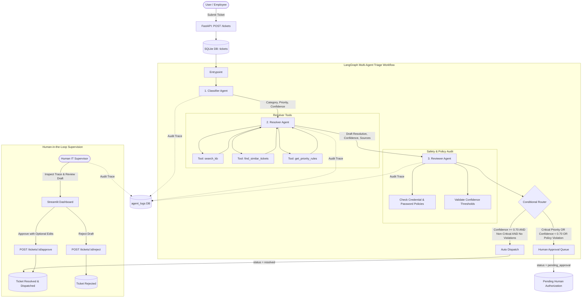

# Agentic Ticket Triage 🛡️

A production-style multi-agent IT support triage and resolution system built with **LangGraph**, **FastAPI**, **SQLite (SQLAlchemy)**, and **Streamlit**.

The platform orchestrates three specialized agents (**Classifier**, **Resolver**, and **Reviewer**) to triage incoming employee support tickets, search a curated knowledge base, retrieve historical precedents, and draft resolutions. A deterministic safety layer guarantees that sensitive, high-impact, or low-confidence tickets are routed to human supervisors for approval before any response is dispatched.

---

## Architecture & Multi-Agent Workflow



---

## Key Features

1. **LangGraph Multi-Agent Orchestration**:
   - **Classifier Agent**: Categorizes tickets into `network`, `access`, `hardware`, `software`, or `other`, assigns severity (`low`, `medium`, `high`, `critical`), and scores classification confidence.
   - **Resolver Agent**: Leverages plain Python tools to query the 10 knowledge base articles in `kb/`, searches past resolved tickets in SQLite, and drafts an empathetic, step-by-step resolution.
   - **Reviewer Agent**: Audits draft resolutions against security policies (strictly prohibits requesting or exposing passwords/credentials) and flags missing information.
2. **Deterministic Conditional Routing**:
   - Tickets marked as **Critical** priority *always* require human authorization.
   - Any ticket where **Classifier**, **Resolver**, or **Reviewer** confidence falls below **0.70** *always* routes to human approval.
   - Any detected policy violation *always* triggers escalation.
   - Clean, verified tickets with confidence $\ge 0.70$ are automatically resolved and dispatched.
3. **Comprehensive Observability & Explainability**:
   - Every agent execution step (inputs, prompts, outputs, reasoning, timestamps) is permanently recorded in the `agent_logs` table.
4. **Human-in-the-Loop (HITL) Dashboard**:
   - Streamlit interface allows supervisors to view pending tickets, read full agent reasoning traces, edit resolution drafts inline, and approve or reject tickets.
5. **Robust Error Handling**:
   - Retries invalid LLM JSON payloads with explicit schema correction prompts, coupled with safe deterministic fallbacks.
6. **Swappable LLM Interface**:
   - Seamlessly switch between the offline deterministic `MockLLMClient` (zero API keys required) and `OpenAILLMClient` (or any OpenAI-compatible API).

---

## Tech Stack

- **Orchestration**: LangGraph 1.2+ (TypedDict shared state)
- **Backend API**: Python 3.11 + FastAPI + Uvicorn
- **Data Persistence**: SQLite via SQLAlchemy 2.0+ (foreign key constraints enforced)
- **Validation**: Pydantic v2 + Pydantic Settings + email-validator
- **Frontend Dashboard**: Streamlit 1.32+
- **Testing**: Pytest 8.0+ (21 integration and unit tests with mocked LLM)
- **Containerization**: Docker (multi-stage python:3.11-slim) + Docker Compose
- **CI/CD**: GitHub Actions workflow running automated test matrix on push

---

## Folder Structure

```
agentic-ticket-triage/
├── app/
│   ├── __init__.py
│   ├── config.py           # Pydantic Settings configuration
│   ├── db.py               # SQLite engine and session factory
│   ├── models.py           # SQLAlchemy models: Ticket, AgentLog, Approval
│   ├── schemas.py          # Pydantic validation schemas and agent outputs
│   ├── llm.py              # Swappable LLM client (Mock & OpenAI) + JSON parser
│   ├── tools.py            # search_kb, find_similar_tickets, get_priority_rules
│   ├── graph.py            # LangGraph StateGraph, nodes, and conditional router
│   ├── main.py             # FastAPI REST endpoints and lifecycle handlers
│   └── agents/
│       ├── __init__.py
│       ├── classifier.py   # Classifier agent node
│       ├── resolver.py     # Resolver agent node (KB + ticket retrieval)
│       └── reviewer.py     # Reviewer agent node (safety & policy checks)
├── ui/
│   ├── __init__.py
│   └── dashboard.py        # Streamlit interactive operations dashboard
├── kb/                     # 10 realistic IT knowledge base markdown articles
│   ├── vpn_troubleshooting.md
│   ├── password_reset_policy.md
│   ├── wifi_connectivity.md
│   ├── email_client_setup.md
│   ├── software_installation_policy.md
│   ├── hardware_replacement.md
│   ├── monitor_display_issues.md
│   ├── slack_zoom_collaboration.md
│   ├── printer_access_configuration.md
│   └── security_incident_reporting.md
├── scripts/
│   └── seed_tickets.py     # Database seeder populating 10 realistic tickets
├── tests/
│   ├── conftest.py         # In-memory test fixtures and client overrides
│   ├── test_classifier.py  # Validation, retry, and fallback tests
│   ├── test_tools.py       # Knowledge search, ticket similarity, SLA tests
│   ├── test_routing.py     # Routing logic, critical paths, low-confidence checks
│   ├── test_api.py         # REST endpoint tests (/tickets, filtering, 404s)
│   └── test_approvals.py   # HITL approval, edit resolution, and rejection tests
├── .github/
│   └── workflows/
│       └── ci.yml          # GitHub Actions CI workflow
├── Dockerfile              # Container image definition
├── docker-compose.yml      # Multi-service composition (Backend + Frontend)
├── pyproject.toml          # Pytest and build configuration
├── requirements.txt        # Pinned project dependencies
├── .env.example            # Sample environment variables
├── .gitignore              # Git ignore rules
└── README.md               # Project documentation
```

---

## Quickstart & Local Setup

### 1. Prerequisites
- Python 3.11+
- Git

### 2. Clone and Setup Environment

```bash
git clone https://github.com/Bhargav221287/agentic-ticket-triage.git
cd agentic-ticket-triage

# Create virtual environment
python -m venv venv

# Activate virtual environment
# Windows (PowerShell):
.\venv\Scripts\Activate.ps1
# Linux / macOS:
source venv/bin/activate

# Install dependencies
pip install --upgrade pip
pip install -r requirements.txt
```

### 3. Configure Environment Variables

Copy the example environment template:

```bash
cp .env.example .env
```

By default, `LLM_PROVIDER=mock`, allowing full end-to-end functionality, UI interaction, and test execution without external API keys. To connect a live LLM:

```ini
LLM_PROVIDER=openai
LLM_API_KEY=sk-...
LLM_MODEL=gpt-4o-mini
```

### 4. Seed Sample Tickets

Populate the local SQLite database (`triage.db`) with 10 realistic tickets:

```bash
python scripts/seed_tickets.py
```

### 5. Launch the Backend API

```bash
uvicorn app.main:app --reload --host 0.0.0.0 --port 8000
```
- API Docs (Swagger UI): [http://localhost:8000/docs](http://localhost:8000/docs)
- Health Check: [http://localhost:8000/health](http://localhost:8000/health)

### 6. Launch the Streamlit Dashboard

In a new terminal window:

```bash
streamlit run ui/dashboard.py
```
Open your browser at [http://localhost:8501](http://localhost:8501).

---

## Running with Docker Compose

To run the complete stack (FastAPI backend + Streamlit dashboard) in isolated containers:

```bash
# Build and launch services
docker-compose up --build

# Run in background (detached mode)
docker-compose up -d
```

- **Streamlit Dashboard**: `http://localhost:8501`
- **FastAPI OpenAPI Docs**: `http://localhost:8000/docs`

To stop the services:
```bash
docker-compose down
```

---

## API Examples (cURL)

### 1. Submit a New Ticket
```bash
curl -X POST "http://localhost:8000/tickets" \
  -H "Content-Type: application/json" \
  -d '{
    "customer_name": "Jordan Hayes",
    "customer_email": "jordan.hayes@example.com",
    "subject": "Cannot connect to corporate VPN after password update",
    "description": "GlobalProtect gives Gateway Error 403 when connecting to vpn.internal.corp."
  }'
```

### 2. List All Tickets
```bash
curl -X GET "http://localhost:8000/tickets"
```

### 3. List Pending Approvals
```bash
curl -X GET "http://localhost:8000/tickets?status=pending_approval"
```

### 4. Inspect a Ticket and Agent Trace
```bash
curl -X GET "http://localhost:8000/tickets/1"
```

### 5. Approve a Pending Ticket (with Optional Edited Resolution)
```bash
curl -X POST "http://localhost:8000/tickets/5/approve" \
  -H "Content-Type: application/json" \
  -d '{
    "edited_response": "Hello Gregory, our SOC team has contained the infected subnet. Please remain offline.",
    "reviewer_notes": "Verified incident protocol with SOC Lead."
  }'
```

### 6. Reject a Proposed Resolution Draft
```bash
curl -X POST "http://localhost:8000/tickets/6/reject" \
  -H "Content-Type: application/json" \
  -d '{
    "reviewer_notes": "Rejected: Hardware diagnostics must be collected first."
  }'
```

---

## Running Automated Tests

The test suite runs against an isolated SQLite in-memory database using `pytest`:

```bash
pytest -v
```

### Test Suite Summary (21 Passed)
- **Classifier Agent** (`tests/test_classifier.py`):
  - `test_classifier_valid_output`: Pydantic schema validation for category and priority.
  - `test_classifier_retry_on_invalid_json`: Automated prompt re-feeding on malformed JSON.
  - `test_classifier_fallback_on_complete_failure`: Graceful fallback schema generation.
- **Tools** (`tests/test_tools.py`):
  - `test_search_kb_finds_vpn_article`: Semantic keyword matching against markdown knowledge articles.
  - `test_search_kb_empty_query` & `test_search_kb_nonexistent_directory`: Boundary and error conditions.
  - `test_find_similar_tickets`: Vector-like token overlap retrieval on historical resolved cases.
  - `test_get_priority_rules`: SLA verification and HITL mandatory policies across all 4 priorities.
- **Routing & Policies** (`tests/test_routing.py`):
  - `test_routing_function_unit_checks`: Deterministic rule evaluations.
  - `test_critical_priority_graph_execution`: Enforces human approval on critical tickets.
  - `test_low_confidence_graph_execution`: Enforces human approval when confidence is below 0.70.
  - `test_clean_ticket_auto_resolves`: Direct dispatch when criteria are met.
  - `test_policy_violation_forces_human_approval`: Intercepts password exposure attempts.
- **REST Endpoints** (`tests/test_api.py`):
  - `test_health_and_root`: Health checks.
  - `test_submit_ticket_creates_and_triages`: Complete lifecycle API verification.
  - `test_list_tickets_and_filtering`: Category and status filtering.
  - `test_get_ticket_by_id_and_not_found`: 200 payload and 404 validation.
- **Approvals & Supervision** (`tests/test_approvals.py`):
  - `test_approve_ticket_endpoint`: Status transition to resolved.
  - `test_approve_ticket_with_edited_resolution`: Human text override integrity.
  - `test_reject_ticket_endpoint`: Rejection handling and audit trail recording.
  - `test_approve_non_pending_ticket_returns_400`: Invalid state transition prevention.

---

## Limitations and Responsible AI

### 1. Hallucinated Fixes & Grounding
- **Risk**: Generative models may hallucinate IT configuration commands (e.g., incorrect shell scripts, unverified registry keys) that could disable an employee's machine.
- **Mitigation**: The Resolver Agent is constrained by retrieval-augmented generation (RAG) using curated markdown files in `kb/`. In addition, confidence scores below 0.70 automatically trigger human supervisor review.

### 2. Privacy & Credential Safety
- **Risk**: IT support interactions often touch authentication issues where an automated system might solicit passwords or share unencrypted secrets.
- **Policy Enforcement**: The system strictly forbids asking users for credentials. Deterministic regex checks combined with the Reviewer Agent intercept any phrasing resembling "send me your password" or "enter your credentials", forcing an escalation and recommending the self-service SSPR portal (`https://identity.internal.corp/sspr`).

### 3. Human-in-the-Loop (HITL) Rationale
- High-severity incidents (e.g., suspected ransomware, core infrastructure outages) involve existential business risk where autonomous agent replies are inappropriate.
- Routing all Critical tickets and low-confidence drafts to human supervisors ensures operational safety, accountability, and compliance with enterprise audit standards.

---

## AI Assistance & Output Verification

### AI-Assisted Components
- Multi-agent state transition definitions and LangGraph workflow structure.
- Synthetic knowledge base documentation across 10 realistic corporate IT scenarios.
- Comprehensive test fixtures and edge-case simulation suites.

### Verification Methodology
- **Automated Verification**: 21 unit and integration tests executing with 100% pass rate in an isolated environment.
- **Database Consistency**: SQLite foreign key constraints verified with active `PRAGMA foreign_keys=ON;`.
- **Schema Enforcement**: Full Pydantic v2 runtime validation on all agent inputs and outputs.
- **Live Integration Testing**: Verified live execution via `POST /tickets`, seeded data queries via `GET /tickets`, and interactive verification through the Streamlit dashboard.
